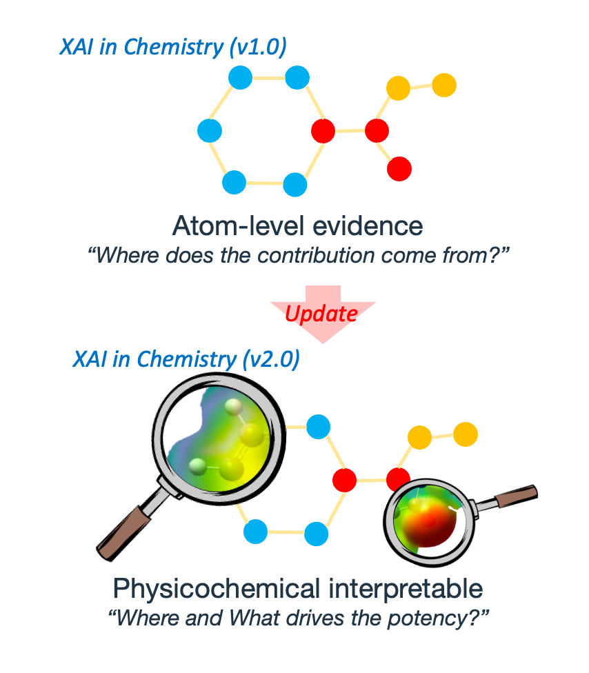
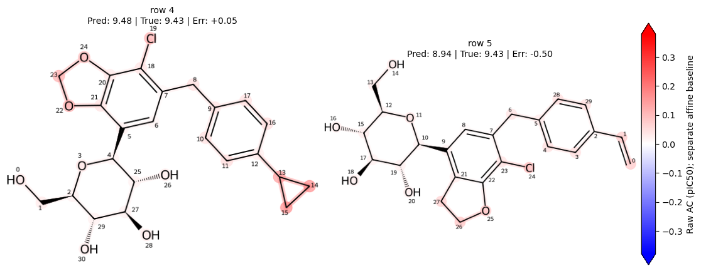

# XAI-Chem-SPIRE

**Surrogate-based Physicochemical Interpretation of Regularized Evidence**

SPIRE explains molecular property predictions in physicochemical terms. A graph neural network assigns a contribution to each atom; chemical regularization encourages consistent contributions for shared structures. A descriptor-based surrogate then approximates these contributions to relate prediction evidence to properties such as electronic character and molecular flexibility.

Developed and tested using **Google Colab** and **macOS**. Dependency versions are listed in [requirements.txt](requirements.txt).

  

## Atom contributions and their interpretation

An **atom contribution (AC)** is an atom's signed contribution to the model prediction. The atom contributions sum to the prediction together with a separate affine baseline. Red denotes positive contributions and blue negative contributions; both molecules below use the same raw scale.

*Existing regularized SGLT2 results (fold 0). These maps describe model evidence, not experimentally measured atomic effects.*

**Descriptor-based reconstruction** fits a simple surrogate to approximate the learned ACs from atom-level physicochemical descriptors. It helps describe which properties account for the model's evidence; it does not establish a causal mechanism.

## SGLT2 case study

| Executed notebook | Purpose | Data source |
|---|---|---|
| [Training R](notebooks_for_sglt2/output/executed_notebooks/01_training_R_executed.ipynb) · [U](notebooks_for_sglt2/output/executed_notebooks/01_training_U_executed.ipynb) | SGLT2 model training and AC regularization | [ChEMBL 37](https://www.ebi.ac.uk/chembl/), CHEMBL3884 |
| [Reference reconstruction](notebooks_for_sglt2/output/executed_notebooks/02_reconstruction_executed.ipynb) | In-sample reconstruction of reference R ACs | [This study](sglt2_data/README.md): reference ACs and computed descriptors |

## Additional examples

The same workflow is also illustrated on other molecular prediction tasks.

| Executed notebook | Purpose | Data source |
|---|---|---|
| [FreeSolv](test_sample/output/executed_notebooks/freesolv_executed.ipynb) | Hydration free energy | [FreeSolv v0.52](https://github.com/MobleyLab/FreeSolv) |
| [LD50](test_sample/output/executed_notebooks/ld50_toxicity_executed.ipynb) | Acute oral toxicity | [TDC / Zhu et al.](https://tdcommons.ai/single_pred_tasks/tox/#acute-toxicity-ld50) |
| [Lipophilicity](test_sample/output/executed_notebooks/lipophilicity_executed.ipynb) | Lipophilicity (logD) | [TDC / AstraZeneca](https://tdcommons.ai/single_pred_tasks/adme/#lipophilicity-astrazeneca) |
| [Caco-2](test_sample/output/executed_notebooks/caco2_executed.ipynb) | Intestinal permeability | [TDC / Wang et al.](https://tdcommons.ai/single_pred_tasks/adme/#caco-2-cell-effective-permeability-wang-et-al) |
| [Mayr / DCM](test_sample/output/executed_notebooks/mayr_dcm_executed.ipynb) | Nucleophilicity | [BNNLab / Mayr](https://github.com/BNNLab/Nucleophilicity) |

[Data sources and licenses](sglt2_data/README.md)

## Citation

If you use SPIRE or this code in your research, please cite the accompanying manuscript:

> Yusuke Tateishi, Junwei Shen, Masayoshi Aritsugi, and Shinichiro Nakamura. *Physicochemical Interpretation of Atom Contributions to Molecular Property Predictions*. Unpublished manuscript.

DOI: *** (to be assigned).
