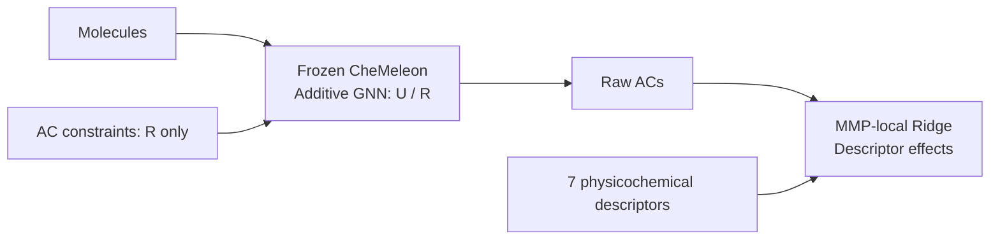

# XAI-Chem-SPIRE

**Surrogate-based Physicochemical Interpretation of Regularized Evidence**

Regularize **atom contributions (ACs)** and reconstruct them with physicochemical descriptors.



**U:** unregularized; **R:** regularized; **MMP:** matched molecular pair.
R constrains core differences, changed-region agreement, fragment positivity and consistency.

## Setup

Python **3.11+**; tested: **3.12.5, macOS arm64**.
For [recorded versions](requirements-tested.txt), add `-c requirements-tested.txt` to pip install.

```bash
git clone https://github.com/yu-tateyan-15/XAI-Chem-SPIRE.git
cd XAI-Chem-SPIRE
python -m pip install -r requirements.txt
python -m ipykernel install --sys-prefix --name xai-chem --display-name "XAI-Chem-SPIRE"
export XAI_CHEM_ROOT="$PWD"
mkdir -p notebooks_for_sglt2/output/executed_notebooks
```

Run from the repository root; select this kernel for interactive use.
**Training/examples also need the encoder:**

```bash
mkdir -p checkpoints
curl -L --fail https://zenodo.org/records/15460715/files/chemeleon_mp.pt \
  -o checkpoints/chemeleon_mp.pt
```

## SGLT2: choose a starting point

| Notebook | What you inspect | Prerequisite |
|---|---|---|
| [02_reconstruction](notebooks_for_sglt2/02_reconstruction.ipynb) | 23,029 MMP fits and descriptor effects | Bundled ACs; no weights |
| [01_training](notebooks_for_sglt2/01_training.ipynb) | R/U training, AC audits and maps | CheMeleon encoder |

**Reconstruction only:**

```bash
python -m papermill notebooks_for_sglt2/02_reconstruction.ipynb \
  notebooks_for_sglt2/output/executed_notebooks/02_reconstruction_executed.ipynb \
  -k xai-chem
```

**Train both conditions, all five folds:**

```bash
for condition in R U; do
  python -m papermill notebooks_for_sglt2/01_training.ipynb \
    "notebooks_for_sglt2/output/executed_notebooks/01_training_${condition}_executed.ipynb" \
    -k xai-chem -p CONFIG_PATH "configs/sglt2_${condition}.json"
done
```

| Setting | R | U |
|---|---|---|
| Population / split | 1,259 molecules; fixed 5-fold, seed 42 | Same |
| Model | GATv2; frozen CheMeleon inputs | Same |
| AC regularization | Four constraints; fixed fold scales | Disabled |
| Maximum epochs | 150 | 200 |
| Checkpoint selection | Best validation; patience 50 epochs | Same |

CPU is the default; `-p RUN_MODE reuse` reads a matching completed run.
For newly trained ACs, append to the reconstruction command:

```text
-p ATOM_CONTRIBUTIONS_PATH notebooks_for_sglt2/output/sglt2/R/fold_0/atom_contributions.csv
```

Use `U` for the control. Preserve reconstruction outputs before switching teachers.

## Independent validation examples

U/R training, AC audits/maps, Y–Y plots and MMP reconstruction.

| Notebook | Target | Input |
|---|---|---|
| [FreeSolv](test_sample/freesolv.ipynb) | Hydration free energy, kcal/mol | Bundled v0.52 |
| [LD50](test_sample/ld50_toxicity.ipynb) | log10[1/(LD50 in mol/kg)] | Bundled source; 1,024-molecule sample |
| [Lipophilicity](test_sample/lipophilicity.ipynb) | logD at pH 7.4 | Downloaded |
| [Caco-2](test_sample/caco2.ipynb) | log10(Papp / cm s⁻¹) | Downloaded |
| [Mayr / DCM](test_sample/mayr_dcm.ipynb) | Nucleophilicity N in dichloromethane | Downloaded |

```bash
mkdir -p test_sample/output/executed_notebooks
python -m papermill test_sample/freesolv.ipynb \
  test_sample/output/executed_notebooks/freesolv_executed.ipynb -k xai-chem
```

Switch notebook stems for other examples. All use a two-layer GCN, 100 epochs,
one random split and seven RDKit descriptors. Lipophilicity, Caco-2 and Mayr/DCM
also report five WISP metrics.

## Files and outputs

| Location | Contents |
|---|---|
| `configs/` · `sglt2_data/` | R/U settings; fixed molecules, folds, MMPs, physical descriptors and reference ACs |
| `xai_chem/` | Shared models, losses, reconstruction, metrics and plotting |
| `notebooks_for_sglt2/output/sglt2/{R,U}/fold_*/` | Generated models, predictions and per-atom AC tables |
| `notebooks_for_sglt2/output/sglt2/vis/` | Training figures |
| `notebooks_for_sglt2/output/reconstruction/{csv,vis}/` | Reconstruction tables and figures |
| `test_sample/output/<RUN_NAME>/` | Example results |
| `output/executed_notebooks/` | Executed computational records |

Outputs are ignored; weights are not bundled. SGLT2 physical descriptors are
precomputed inputs. Figures use [the shared style](xai_chem/plotting.py).

## Interpretation and sources

- ACs decompose model predictions with a separate affine baseline; they are not causal effects.
- Ridge fidelity is **in-sample** on changed-region atoms. MMPs can share molecules.
- Training uses deterministic Torch kernels; hardware/dependency changes can alter results.
- Use raw AC tables or shared map limits. Examples are single-split checks, not scaffold benchmarks; weight suitability depends on the endpoint.

[Data sources and notices](sglt2_data/README.md) · [Example acquisition notes](test_sample/input_data)
ChEMBL: CC BY-SA 3.0; FreeSolv and LD50: CC BY 4.0; downloaded sources retain upstream terms.
Credit [CheMeleon](https://github.com/JacksonBurns/chemeleon) and the datasets;
WISP: [Janssen et al.](https://doi.org/10.1039/D5DD00398A).
